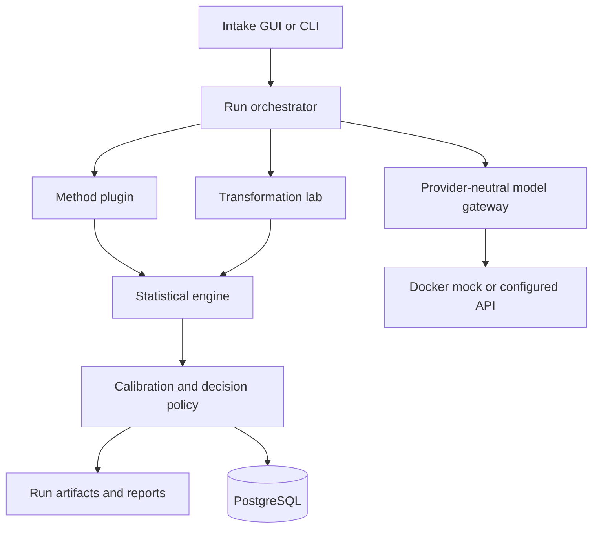

# System Architecture

## Recommended architecture

Use a modular monolith for the MVP. Detectors and creators are plugins behind stable interfaces, while the GUI, CLI, run engine, storage, and reporting remain in one Python application. This is easier to audit and reproduce than premature microservices.

The Docker mock is an external test dependency, not part of the production decision engine. Real provider connectors remain replaceable boundary adapters.



## Component boundaries

- `core`: immutable run manifest, hashing, normalization, tokenizer contracts, statistics, decisions.
- `detectors`: keyed detection and keyless forensic adapters.
- `watermarkers`: generation-time watermarking and payload encoding.
- `attacks`: reproducible transformations with severity and seed metadata.
- `agents`: research and reverse-engineering assistants. They propose specifications and tests but cannot alter production keys or final decisions.
- `services`: model endpoints, extraction, report generation, and job orchestration.
- `storage`: SQLAlchemy models, repositories, migrations, and artifact paths.
- `gui`: Intake, Run Builder, Results, Compare, Create, Research, and Settings screens.

## Core plugin protocols

```python
class DetectorPlugin(Protocol):
    method_id: str
    def detect(self, text: str, config: DetectionConfig) -> DetectionResult: ...

class WatermarkerPlugin(Protocol):
    method_id: str
    def generate(self, prompt: str, config: WatermarkConfig) -> WatermarkedOutput: ...

class TransformationPlugin(Protocol):
    attack_id: str
    def transform(self, text: str, config: AttackConfig) -> TransformedText: ...
```

## Run sequence

1. Intake extracts text and records the original file hash.
2. Normalization produces a separately hashed normalized representation.
3. The orchestrator freezes the method, tokenizer, key ID, threshold, seed, and software version.
4. Each selected method executes as a separate child run.
5. Optional transformations create new immutable child artifacts.
6. Calibration converts raw statistics into a decision and uncertainty statement.
7. Reports link every conclusion to inputs, configuration, code version, and artifacts.

## Model endpoint strategy

Use an OpenAI-compatible endpoint adapter so Ollama Cloud Kimi 2.7 and GLM 5.2 can be configured without coupling the watermark engine to one vendor. Model calls may help generate test corpora, paraphrases, or watermarked output, but deterministic statistical calculations remain local Python code.

Azure OpenAI receives a separate adapter for Azure deployment names, API versions, managed identity, and key-vault integration. GPT-5.6 Luna, Kimi 2.7 Code, and GLM 5.2 are configured as model profiles rather than embedded in business logic.

### What the non-Anthropic ensemble can do

- Identify stylistic or token-distribution hypotheses worth testing.
- Generate matched paraphrases and adversarial transformations.
- Label passages for an experimental supervised classifier.
- Compare provider-output corpora under blinded conditions.
- Critique false-positive explanations and experimental design.

### What it cannot do

- Know Claude's hidden key or unpublished detector.
- convert stylistic resemblance into verified Claude provenance.
- distinguish Claude generation from Claude proofreading solely from prose.
- replace statistical calibration and held-out controls.

## GUI recommendation

PySide6 is recommended for the initial installable Windows desktop application. It supports mature file dialogs, tables, plots, background workers, and later packaging with PyInstaller. A web UI can be added after the run engine is stable.
